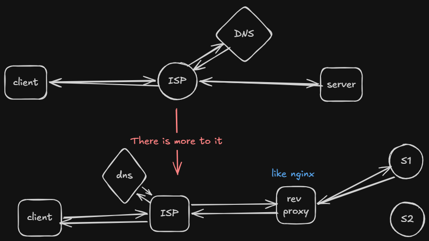
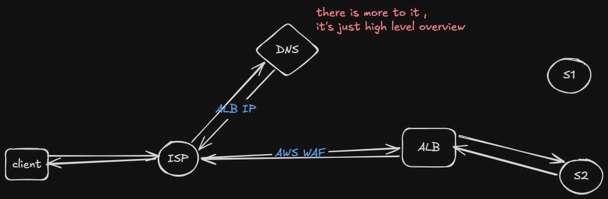

---
tags:
  - theory
  - backend
  - BFFP
  - server
---

## Q1. What is backend ?
## Ans. It is reliable systems that works behind client's req.

## Q2. What is server ?
## Ans. A machine that is 24/7 listening http,grpc, web sockets or any other req through an open port like 83,443 etc ... ( these are the open ports that is accessible by the anyone on the internet )

## Q3. Why is backend ?
## Ans. Sab kch fronted p to krenge nai .. ek centralised place to chahiye to manage db , reduce overhead etc etc

- security of client's machine 
- db ( jitne users utna connection )
- computing power ( we don't know client's machine power )

## Q4. How it works ?

## Ans . This is how the flow looks like :-

- client -> ISP 
- ISP -> DNS server ( returns the ALB's IP not actual server wale EC2 ka IP )
- ISP -> App. Load Balancer 
- ALB -> appropriate server 

### - AWS WAF :- 

- it is like "gatekeeper for your ec2 instance "
- rate limiting , handle bot attacks
- if port not allowed , drop the request

### - Load Balancer :- 

- main job is to distribute the incoming log between multiple servers 
- to improve performance 

### - Reverse Proxy :- 

- server that acts as middle-point between client and actual server ( like load balancer )
- but main job is security and optimisation

