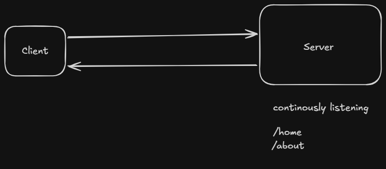

---
tags:
  - theory
  - backend
  - thinking
---



```
Url = Uniform Resource Locator -> it is like address kisi bhi website ka . 
```

## 1. Server 24/7 up and running machine hai , jo harr time listen krte rhti hai specific url pe ( like deployed nai hai to localhost:port pe ) and jab req aati hai to serve krta hai jo bhi dikhana hai usko 


## 2.  How basic deployement works is :-

1. deploy code on github 
2. Buy a machine ( server ) jo hamesha listen krta rhega 
3. you will get a link , agar custom domain hai to wo add krlo 
4. ab jab bhi naya feature daalna hai , git pe push krdo , server providers khud se detect kr lenge and prod mai bhi reflect ho jyga 


