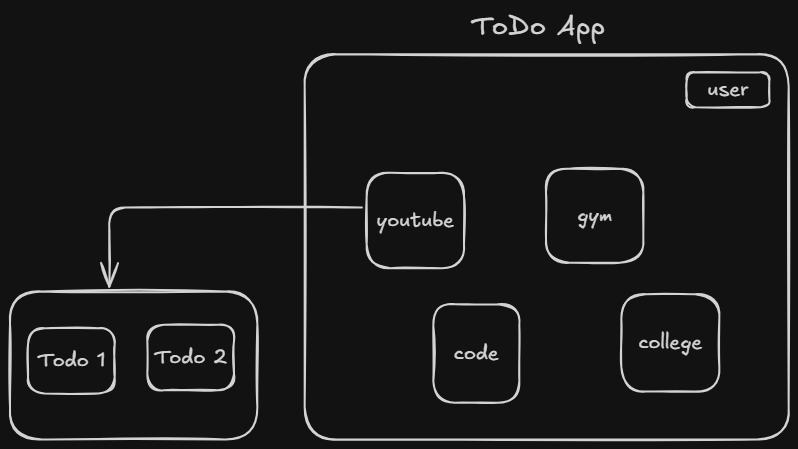
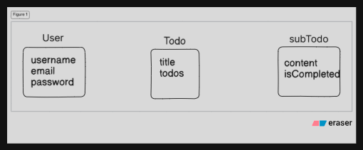

---
tags:
  - theory
  - data_modelling
  - DB
  - backend
---

## So the plan is :- 

- Ek todo app hai usme users honge
- har user ka todos ka sections hoga like yt,code
- uss yt/code ke andar actual todos honge 

## Aise subTodo ka refn dene ke liye we have to use special type callend ObjectId and ref compulsory pass krna hi hota hai.

## The difference between directly holding the values and keeping refn is : [[Refn vs Embedded doc]]

# ==Read docs==

