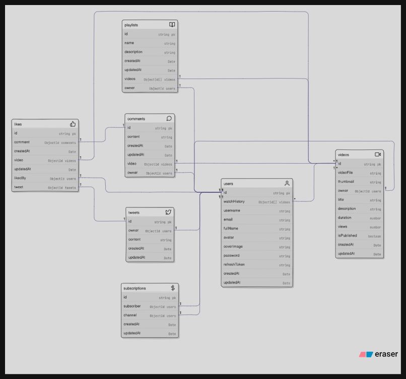

---
tags:
  - theory
  - backend
  - thinking
---

## 1. Sabse phle banata hai ek plan , overview in figma maybe ki kitne pages honge usme kya kya hoga etc etc , usko dekh ke hamm khud ka thought process lagate hai ki ab kaise data store krna hai , kya store krna hai  -> [[04_advice before starting the work|advice]]

## 2. Wo plan dekh ke bhi models pura khud se soch pana requires exp , good amout of exp may be 2-3 years (depends but overall) . **So take it easy and keep thinking**

## 3. Koi fixed fields ya structure nai hota models ka , ye completely requirements + future scope ke basis pe hota hai.  So models can be diffn. ... **functionality chal rhi hai n , good enough optimised hai n** bas , wo bhi sahi model hai .

## 4. For now this is the data model that we are storing :- 

