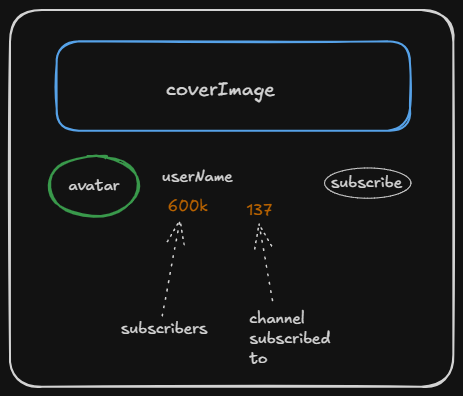
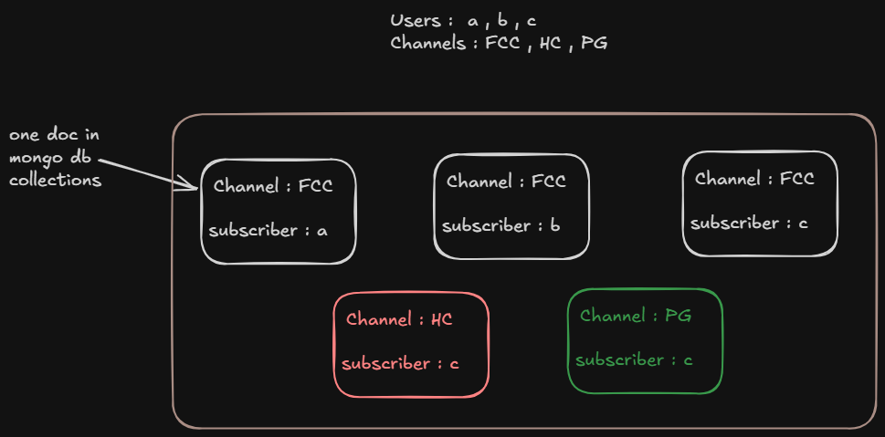

---
tags:
  - theory
  - aggregate
  - thinking
  - backend
  - mongo
---

## Now our target is to make a controller which returns the user profile , like name , coverImage and all baki sb ... so jo user model mai store kr rhe hai wo sb to mil jygaa .. **but how to get the subscriber's count**
	

### 1. One solution can be : store the subscriber Id's in an array into the user ( channel ) model only .. 

- kar skte hai but koi user delete krna hua toh .. pura array search krna pdega .. ( 1m subs case )
- and agar hamko search krna hai ki ek channel ne kitne dusre channel subscribe kiye hai to pura db search krna pdega .. kin kin ke subscribed array mai ye user ( channel ) hai ...
- bhut costly op ho jayga ... need to optimise it . ( dsa application )

### 2. Second soln : Subscription ka ek alg model bnawo .. and usme do field hogi subscriber and channel .

- jab bhi koi channel subscribe hoga , subscription model ka ek doc bnega in subscription collection .. 

#### Q. How to find the subscriber's of FCC channel ? 
#### Ans. Search the collection and just find out how many docs have channel as FCC : number of docs == number of subscribers of FCC !

#### Q. How to find kisi "c" ne kitne channels subscribe kiye hai ?
#### Ans. Search the collection and find out konse doc mai subscriber "c" hai 

