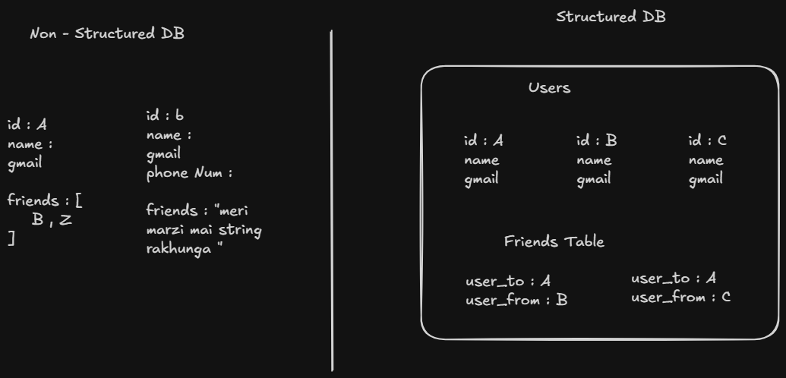

---
tags:
  - theory
  - server
  - DB
---

## Q. Types of  DB ?
### Ans : There are mainly two types of db based on relations .

### 1. Relational database ( Structured db ) : jisme data tables ke form mai ek fixed schema mai hi store hoti hai + they can be related to each other via keys stored in relations table.

### 2. Non - Relational DB : jisme koi structure nai hota hai , therefore more freedom + **extra checks hamko lagane pdte hai db mai dalne se phle** unlike relational jisme db hi error throw kr dega kch galat kroge toh .

