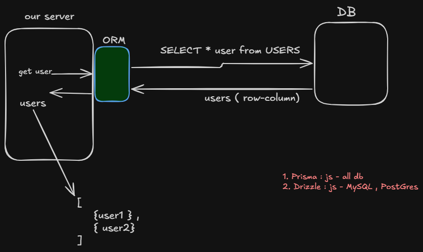

---
tags:
  - theory
  - DB
  - backend
---


## Q. What is the problem ?
### Ans : Our server is written in js and DB understands SQL only , so iska soln hai ya to raw SQL likho manually ya phir ek middle-men use kro jo hamare liye behind the scene ye kaam kre . 


## Q. What is ORM ( Object-Relational Mapper ) ?  
### Ans : It’s a librart/tool  that allows developers to **interact with a database using the programming language’s syntax** instead of writing raw SQL queries .


### Q. Why ORMs ?
- Your **server code** (e.g., in **JavaScript**, **Python**, or **Java**) uses **objects** and classes.
- The **database** uses **tables, rows, and columns** and understands **SQL**.
- These two “speak different languages.”

👉 **ORM acts as a translator (middle-man)** between your **server code** and the **database**:
- It **converts your language’s objects and method calls** into **SQL queries**.
- Then it **maps** the query results back into **objects** you can use in your code.





## Read more about them :- 

1. Prisma : 
	1.  Pros = supports all db .
	2. Cons = thoda sa performance issue when querying foreign relation joint ( as of now ) . 

2. Drizzle : 
	1. Pros : built on top of Prisma , so more optimised as of now .
	2. Cons : support sql only.
```
choosing an ORM is very crucial , so get all the pros and cons and decide what you are ready to trade-off.
```
