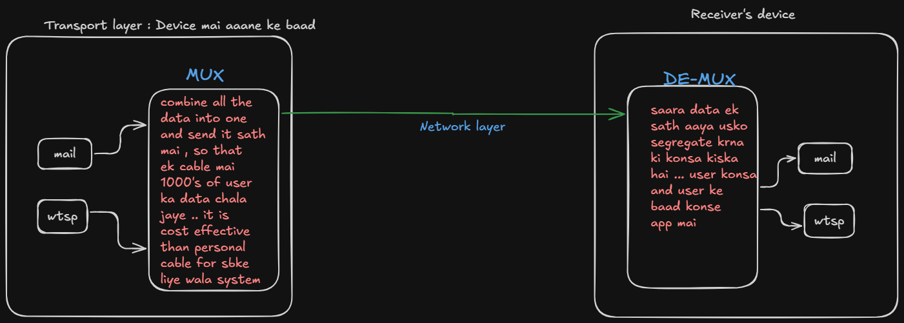

---
tags:
  - theory
  - CN
---

## Network : tfr data from one device to another ... it's protocol is [[IP Address|IP]]

## Transport : get data from network and tfr  within the device to the apps  ... it's protocols are [[TCP Protocol|TCP]] and [[UDP Protocol|UDP]]

## Transport layer does the Multiplexing and de-multiplexing stuff as well ... 

## Network layer does the hoping of ISP routers and keep looking for network (router) address of the destination by using routing tables to find out the next router to send to etc .. ( uses djikstra and other algo as well to find the best path ) 
 
 - read more about it .. how network layer sends data from one device (india) to another device (uk) 