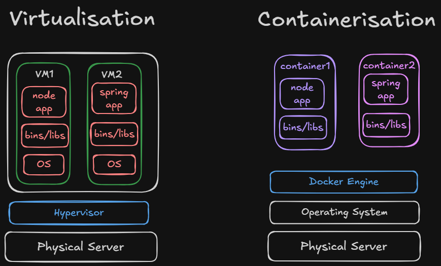

---
tags:
  - containarisation
  - VM
  - docker
---

## Virtualisation : complete isolated machines 

- downside : OS install krne mai time lgta hai , sb kch setup krna is not easy 

## Containerisation : 

- docker engine handles the OS levels 
- it provides the bare min thing required for all OS 

