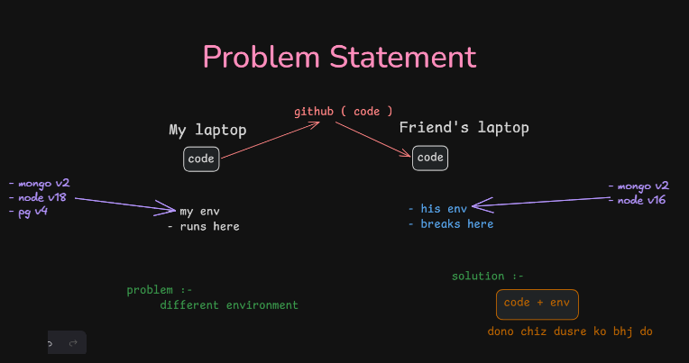
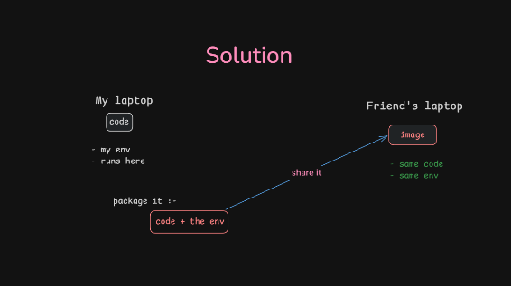

---
tags:
  - docker
---
https://chatgpt.com/g/g-p-6965c66158d88191bf53156a1fd46088-full-stack-overview/c/69f1f258-dbdc-83a3-98d0-237e31908244

## Q. Problem statement :- 

### Ans. Different environments 

## Solution :- 
### Containers ( isolated boxes with all the req thing to run a code )

- pack  the whole code + env ( OS , dependencies etc etc )
- send that whole isolated box  

