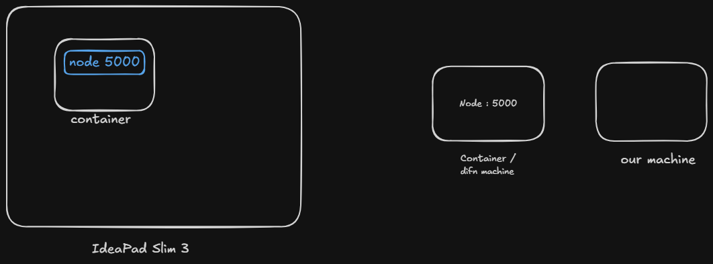

---
tags:
  - docker
---


# We have done all the things but the server is still not accessible ... it is because 

- docker container is like dusri machine 
- so apne machine  se dusre ke kisi bhi port ka access kese hoga 
- isliye port expose krna pdega hamare machine m bhi 
- that is port mapping 





```js
// docker run -it -p <apna port>:<container mai kaha run ho rha hai>

docker run -it -p 6565:5000 my-app   // it will run on our 6565 port

// can also map multiple ports like -p .... -p .... etc 
```


- auto port mapping is also there 


# One more thing , when we run the cmd it blocks the terminal so , 

- we can run it into detachabale form 


```js
docker run -itd my-app

// add d as well 
```

## Also to remove the container as soon as we stop it ,

```js
docker run -itd --rm my-app
```

