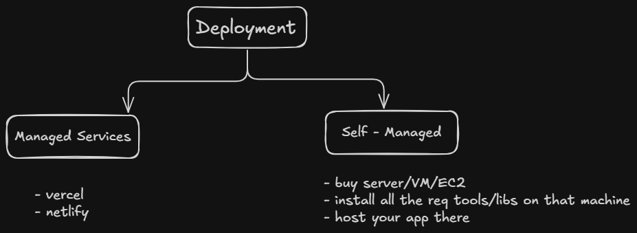

---
tags:
  - deploy
  - react
  - frontend
---





- for deployment , first we have to build our app 

```js
npm run build

// converts all files to html , css and js 
```

- in vite , it creates a distribution folder where it stores them 


### This is done behind the scene when we use any managed service 


## So let's walk through the deployment via managed services :- 


- push your code to github 
- import repo from github in vercel.com 
- env variables wagerah set krna hai to krlo and click deploy
- now continue to dashboard and see all the things there 


( if we want to add domain or any other things all is there )


# What happens when we add new code :- 


- push it to github ( main branch mai hi )
- vercel will automatically build again and make next deployment 