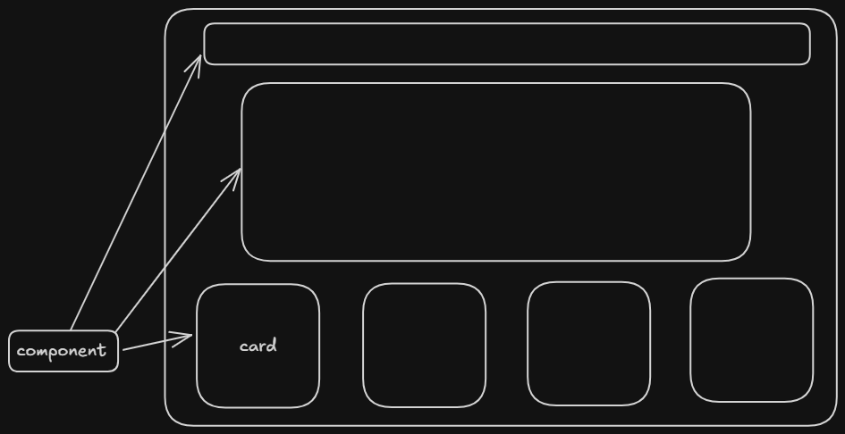

---
tags:
  - react
---

## Rather than having one big web , we break it into components 

- Like for eg we have cards that looks similar ( repeatable card components )

### Props pass krke data ya details change hote hai hai but ek  card component hi rhta hai 

## Now in cards project :- 

- we have three cards 
- they all show same details 
- we can change it but manually krna pdega ( hardcode krke )

# There comes the props !