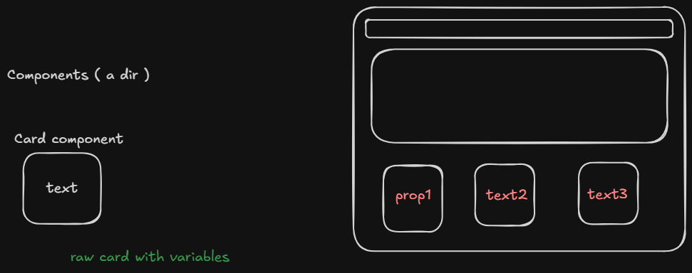

---
tags:
  - props
  - theory
  - react
  - frontend
---

## Q. What is props or properties ?

- it is data or info that goes inside any component 
- we can pass text , image links ofc 
- but we can also pass css and make cards unique for example

## So inside src , we create components folder to store raw components 

- and there we just write that component's whole code ( html , css , js )
- i.e. fully working independent components
- and just import them in main file 

## Now , how to pass props 

- use krte time pass kro 
- and components wale file mai de-structure krke use kro with default values 

