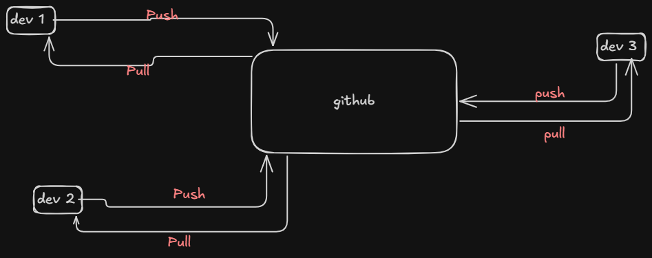

---
tags:
  - theory
  - github
  - git
---

## 1. Git saare changes locally store kr rha hai  ( .git folder mai )


## 2. ==Github is the platform built around git that hosts git repos online ==


## Github is a centralised system that is :-

- A **cloud platform** built _around_ Git
- Hosts Git repositories online
- Makes teamwork (and open source) easy
- Adds collaboration tools:

	- Pull requests
	- Code reviews
	- Issues & project boards
	- CI/CD (GitHub Actions)





### 1. To apne local folder mai jisme .git folder hai usme saare changes track ho rhe hai .. 

### 2. Now git ko btana pdega ki we want to store it into cloud storage .. toh yaha p jaake changes push krdo 

```js
git remote add origin <github_repo_link>  
```

### 3. and to actually push the code there 

```js
git push -u origin <branchName> 

git push -u origin main  
```