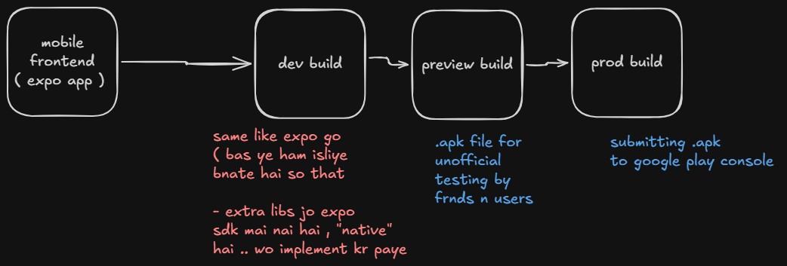

---
tags:
  - expo
---
https://gregarious-gray-075.notion.site/Expo-Application-Services-376c3158e38d805da645da188608262f
https://gregarious-gray-075.notion.site/EAS-Workflow-and-EAS-Submit-and-Publishing-to-Google-Play-Console-378c3158e38d805cb0bcef8d5ad19d7f
https://www.tldraw.com/f/mQeviE3IZLi8quAUEoGja?d=v525.66800.1775.885.page

- we are here talking of expo apps 
- backend to seperate rkhna hai .. uski alg duniya hai 

1. install eas cli and login one time ( just like github cli )
2. eas build cmd 
		- dev : ek nayi app milegi same like expo go working 
		- preview 
		- prod : google isko .aab mai convert krega optimised and testing start krega 

1. eas acc ( usme hi sb kch dikhega )
2. google play console acc ( 25 dollar purchase for uploading or submitting your app to play store )

- dev build : expo jaisa env with native control 
	- expo jaisa mtlb normal code m change kro to waha bhi dikhega 
	- but kch install kiya to dubara se build bnana pdega 

		- isliye good practice is to , install jo bhi chahiye phle se .

## CI / Cd 

- github connect krna pdta hai check kr lena steps 

