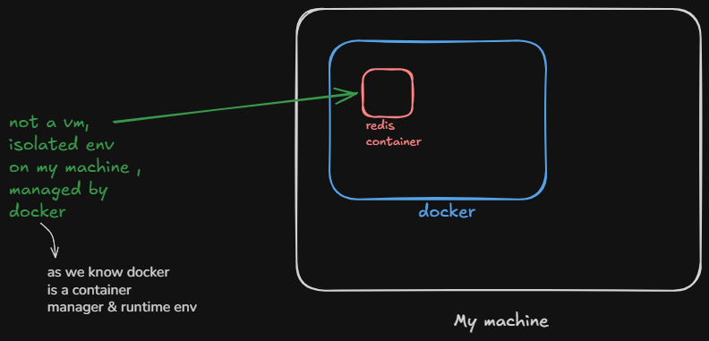
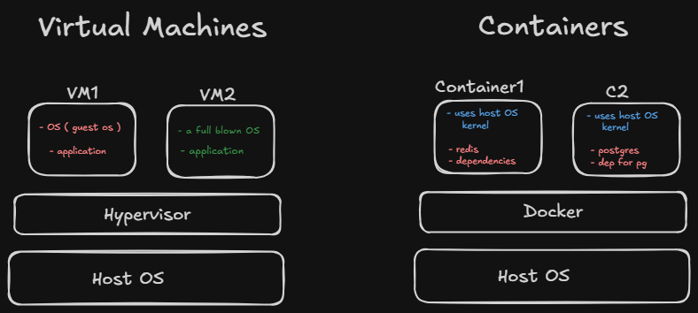

---
tags:
  - redis
  - backend
  - caching
---

## There are mainly 3 ways to setup redis .. 


1. download directly on my machine 
2. managed redis : get the url and connect ( providers will spin up the redis server )


3. Run redis container on docker 


### For learning , I am going with docker .


# So first of all , what are we doing conceptually.





- docker is installed on my machine 

- it helps us to create containers 

  
```
 Containers are isolated environments that can conceptually feel like small, lightweight VMs, but they are not actually VMs because they don't have their own complete OS/kernel.
```





### VM : it virtualises a whole machine / OS env.
### Containers : It isolates applications , but share the same underlying host kernel. 


# So we are going to use redis by creating a docker container of it ... 

- so to connect to redis , the docker container must be running .


- and we know , we have to write a docker file for describing an image and with cli we can run the image ( ie container )


## SO what we have to do is :-


- write docker compose file  ( we need two services here , redis and mongo )
- run docker compose up -d


#### now our redis and mongo apps are running 


- now just need to connect it .
- ioredis : for redis 
- mongoose : for mongodb


