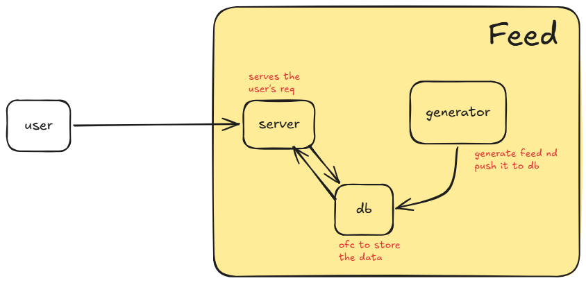
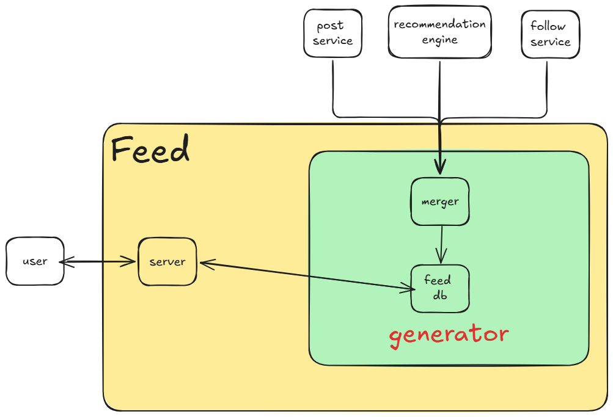

---
tags:
  - sd
---

## Q. Suppose you are given to build any system , how to approach it ?


# eg. **Design Facebook !**


```
take baby steps , no matter what.
go slow , step by step.
```


1. Understand the problem statement thoroughly.
		- core features
		- what not to do ( v imp )
		- tradeoffs 
		- constraints


2. Break down ps into components 
	- auth 
	- feed 
	- notification


3. Dissect each component  ( tackle one component at a time )
		- eg : feed 
		- server ,  generator 
		




4. for ==each sub-component== look into tech decision likes :- 

	- db nd caching :
			-  do we need caching at this point ? 
			- which db or caching service 
			- where to put cache etc 
			
	- scaling nd fault tolerance : 
			- how to scale 
			- kitna scale 
			- how will system behave when any component crashed 
			- how will our system recover after any failure 
			
	- Async processing ( delegation ) :
			- what can be done in bg ?
			- can we delegate this ?
			- eg : feed should not be generated when the user logs in , coz it will take some time to compute the feed hence bad ux , so whenever there is some post or follow request change , invoke the generator asynchronously to generate the feed.

	- Communication :
			- how diffn component will talk to each other 
			- rpc , ws , rest ??


5. If there is need to further break the sub components , do it ( perform splitting till most fundamental level )

	- so in our case , let's continue with feed component
	- we have sub-components as server , db nd generator 
	- server n db : yes we know how it will work 
	- but still need to dissect the generator part 





- follow service : to get the followers of the user 
- recommendation engine : to build the recommendation of the user based on followers nd other ml algo's 
- post service : to get the actual post similar to what recommendation engine predicted 

