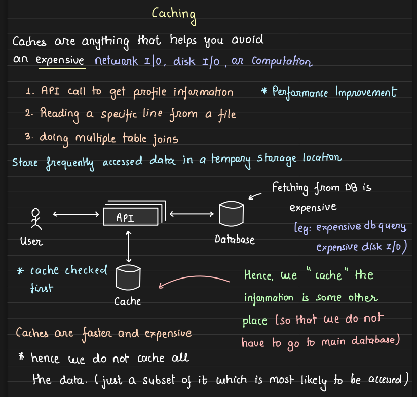

---
tags:
  - sd
  - caching
---

## Cache : any place that reduces the extra network hop nd provides faster data ( ==for performance inc== )

- they are faster , but costlier as well , hence we can't cache all the data .
- stale data ki problem hoti hai , therefore expiry 

- cache : temporary storage location 
- so if in case it goes down , there is no system failure
- there might be some latency / performance lag 
- so keep in mind , if u have to pick for robustness nd availability , ofc always choose db nd make it robust nd fault tolerant  ( cache db also but not that much , u understand ? )

## What to cache , 

- mostly static data like user details etc 
- recently published content ( in blog app , or insta , fb )
- expensive join req 
- most frequntly requested data
