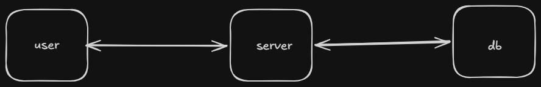
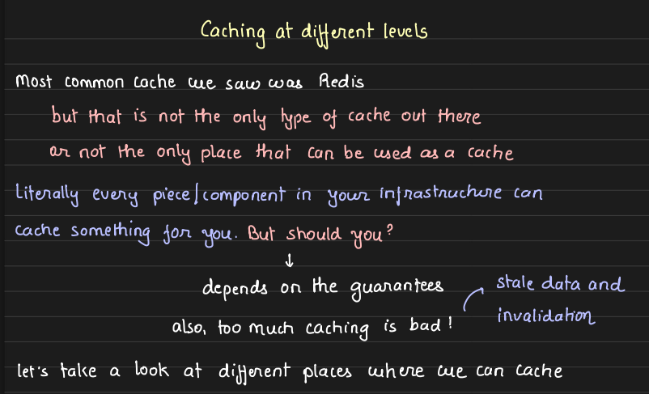
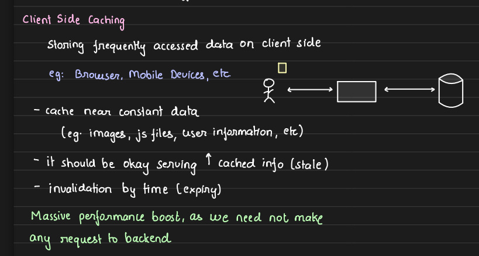
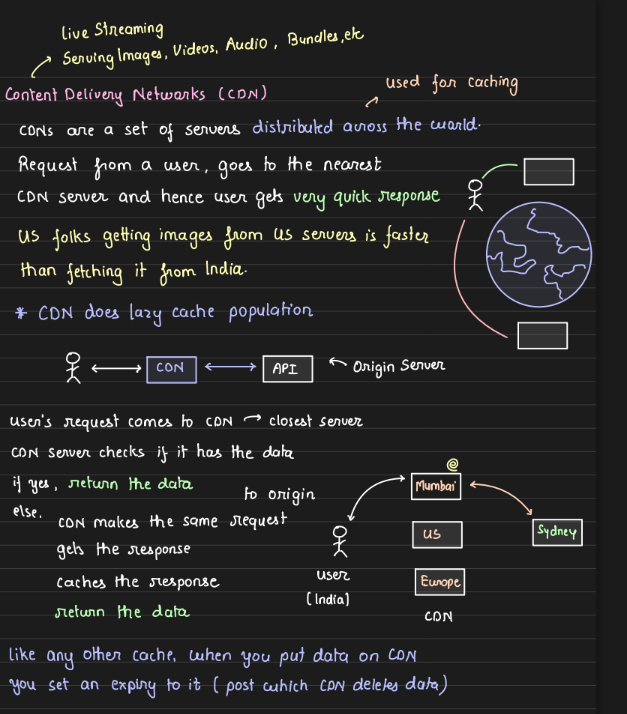
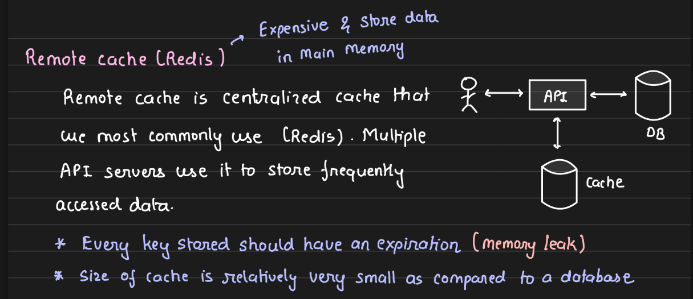
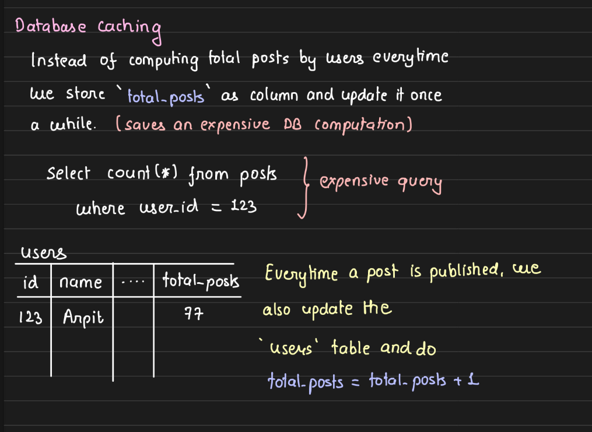
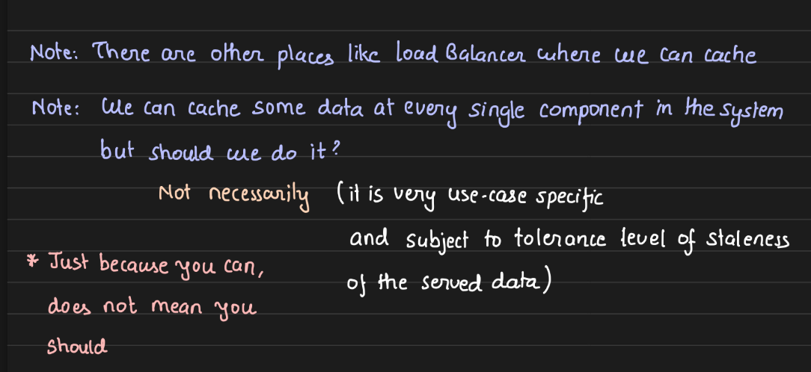

---
tags:
  - sd
  - caching
---
### basic components of a system :- 

#### we can cache things at multiple places , like 

- client side caching : tokens ,  user info
- cdn : images , particular region's celebrity's post 
- server lvl cache ( redis ) : total posts , profile info may be
- db lvl cache : no need to compute frequently accessed things every time , precompute

- caching is good but it comes with it's own down side of staleness 
- so jaha thoda bhut staleness chalege to thik hai , ofc use caching
- but like in bank statements etc jaha user n pay kiya nd abhi bhi statement cache se aa rha hai to , it will not show that txn in the statement , nd it's not good for users n our system 
- therefore , in some systems like banks , where recency nd consistency is most imp , think twice before caching ... what to cache , what not to ? or even do we need cache at all ? 

- sb jagah cache krne mai prblm is invalidation nd layered staleness of data
- like db mai kch change hua to cdn mai , load balancer mai , remote cache mai , client side mai harr jagah update kro