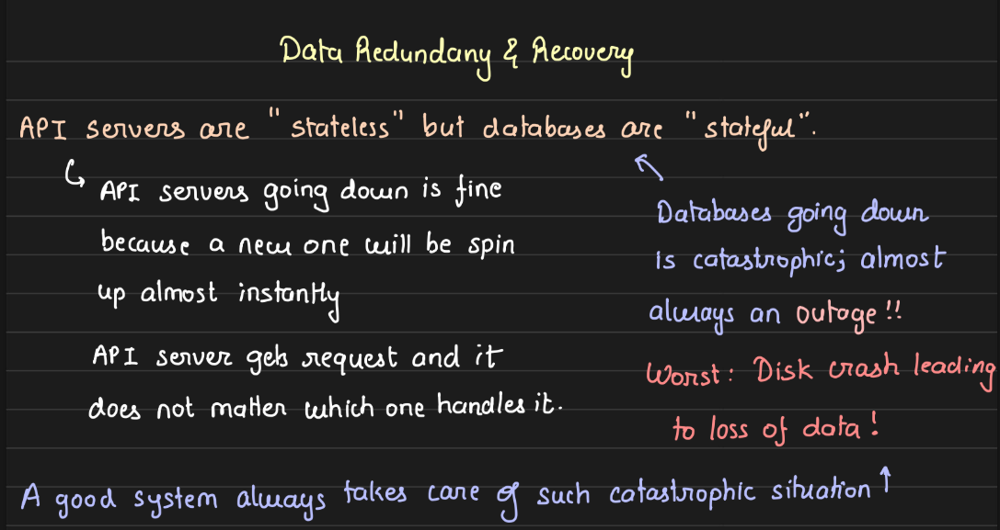
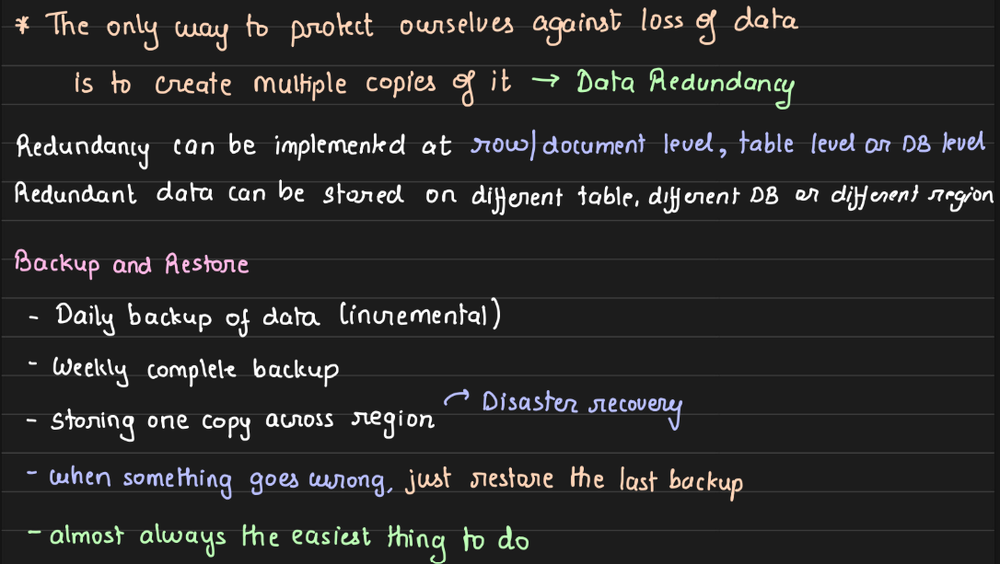
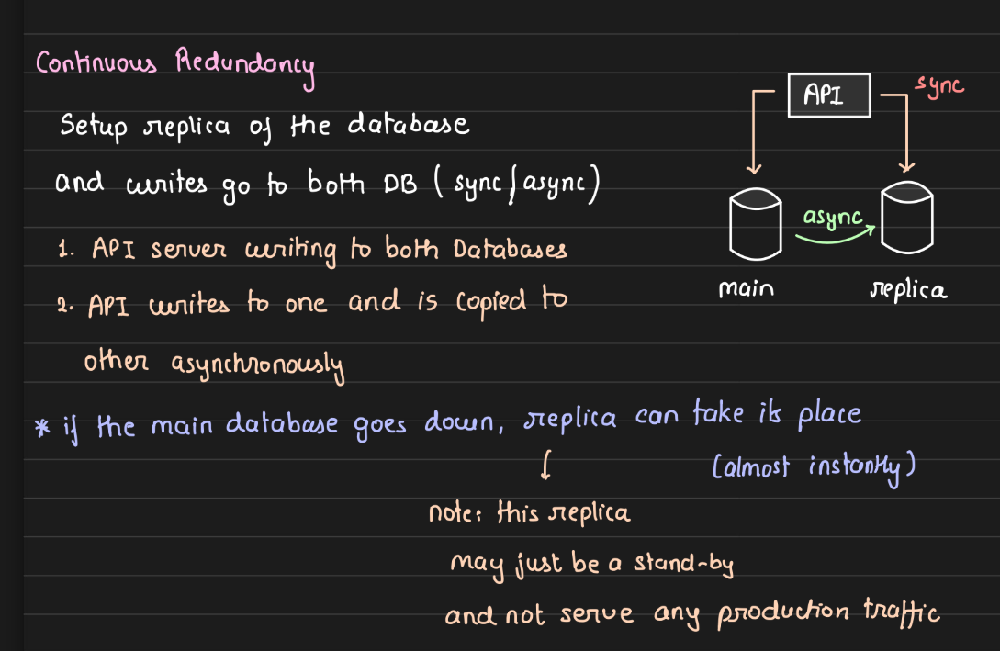

---
tags:
  - DB
  - sd
---

- we use both generally or depends on the use case 
- critical data is generally made continuosly redundant 
- and less critical one can be setup for periodic backups ( that is some data loss is okay , like we have setup weekly backup nd main db crashed 2 days into the week , so we might lost two days data but that is not so so critical  )