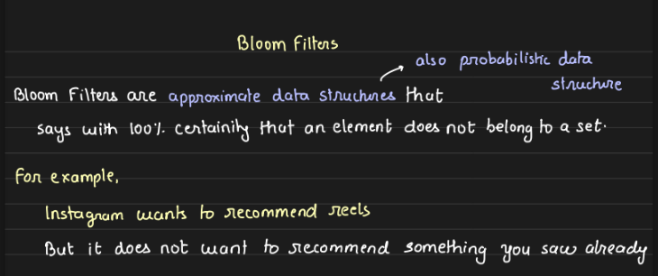
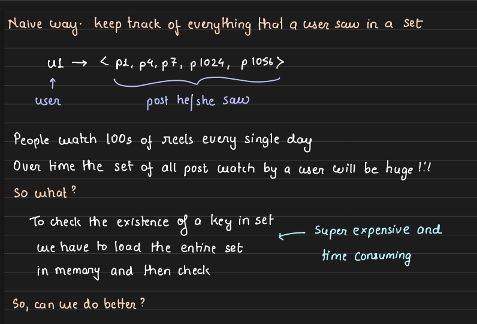
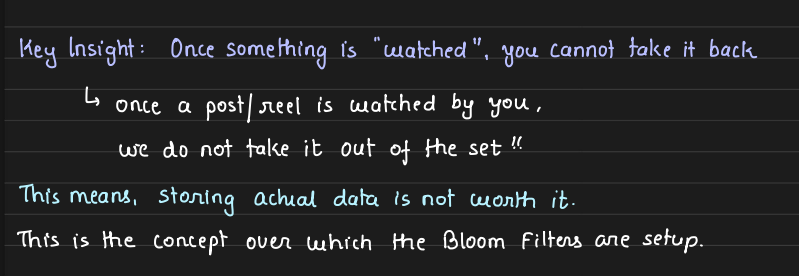
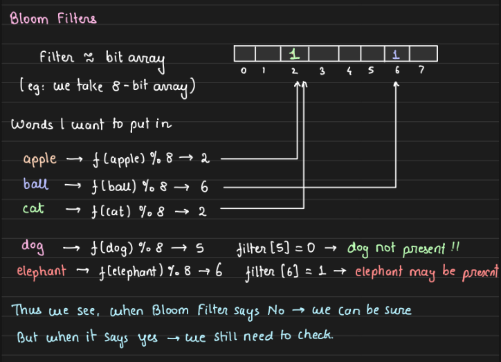
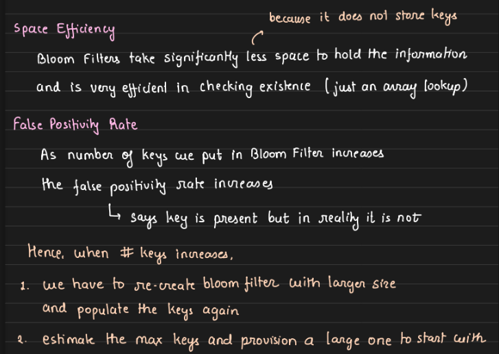
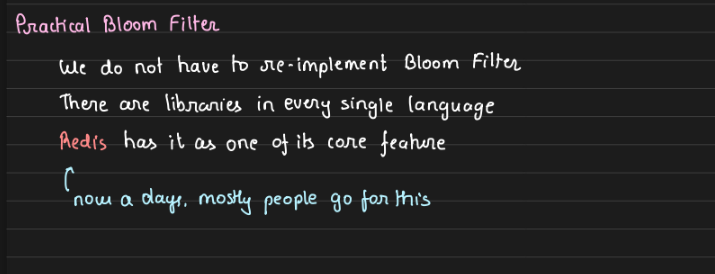
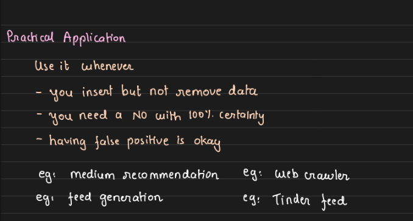

---
tags:
  - sd
---


## Problem : while creating a new account on twitter , user has to pick a unique name 


- so to check if whatever user entered is unique or not 
- we have to make a db call , search whole row ( let say total 10M rows are there )
- and some users might pick 2-3 times the names , that was already taken 
- so for them we'll have O(10M * 3)
- now doing it for every user is costly ( even if it is a O(10M) )


### So to solve this , bloom filters came into picture 


- I dont know how internally it works 
- but main applied concept to focus on 

		- if the user entered name that is not taken , it will return no with 100 percent surity
		- else , it says "username might be present"

- works on false positivity , like it may say username is taken but in reality koi nai liya ho 


```
saumya : taken ( bloom filters )     - actually taken 
saumya2 : taken ( bloom filters )    - actually not taken 

saumyajha : not taken ( bloom filters )  - 100 percent this username isn't taken
```


##### So to tackle false positive , two options that comes to my mind , 

- let the resource gets wasted ( kch username koi nai liya hai twitter mai ya kch reel user kbhi na dekhe .. and for this tradeoff we're getting surity that duplicate reel kbhi nai jygi user feed mai ) 
- search in db when bloom filter says may be 
		- worst case : O(n)








