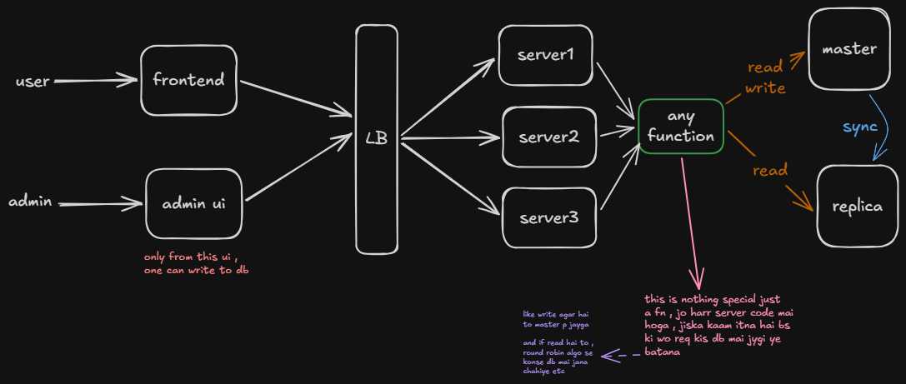
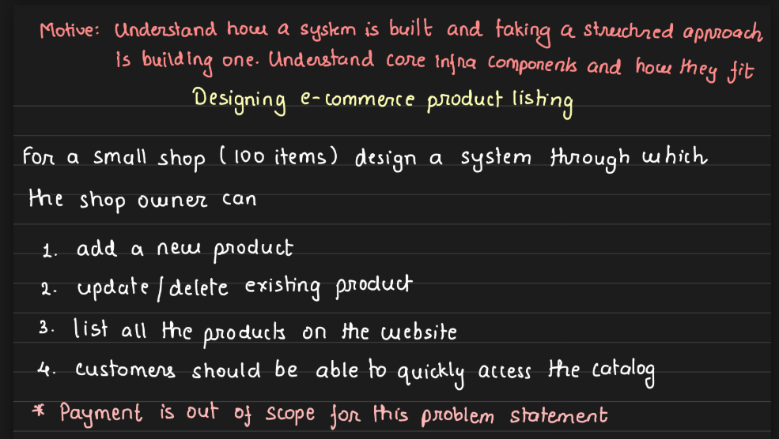
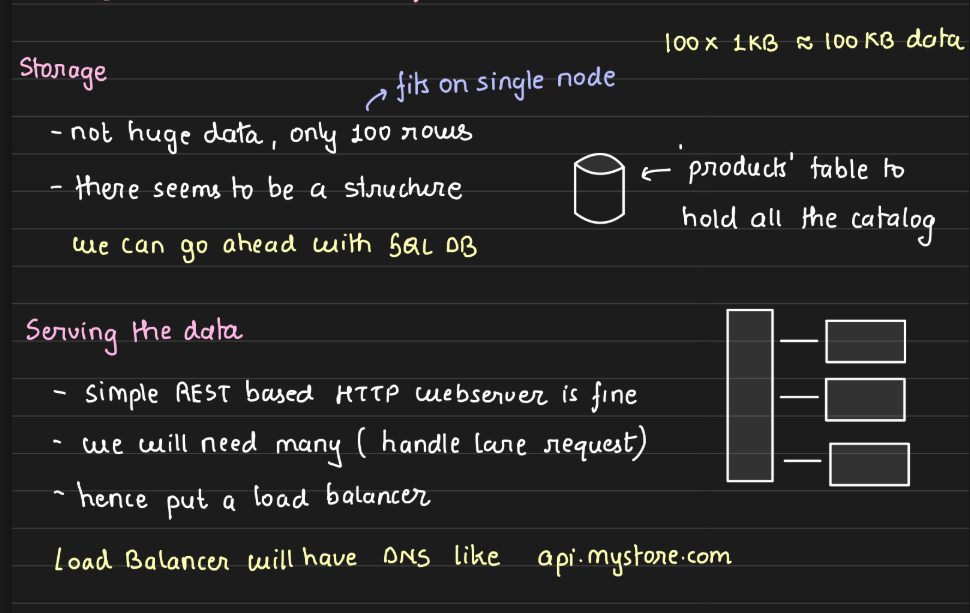
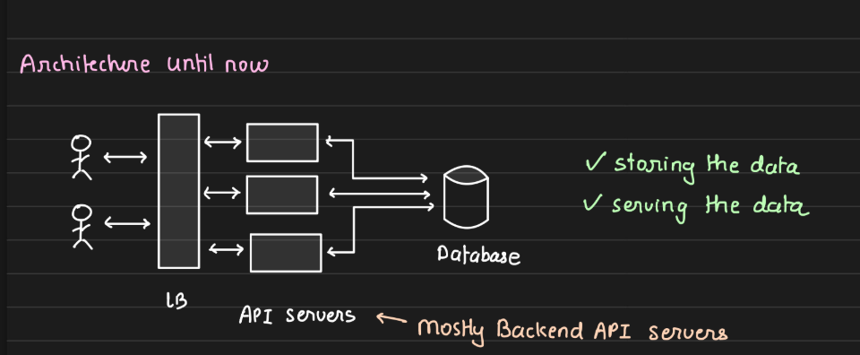
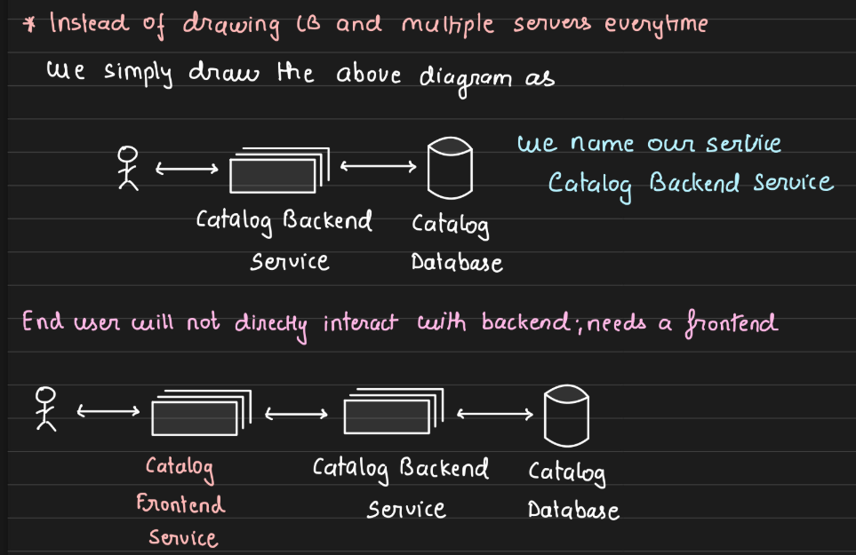
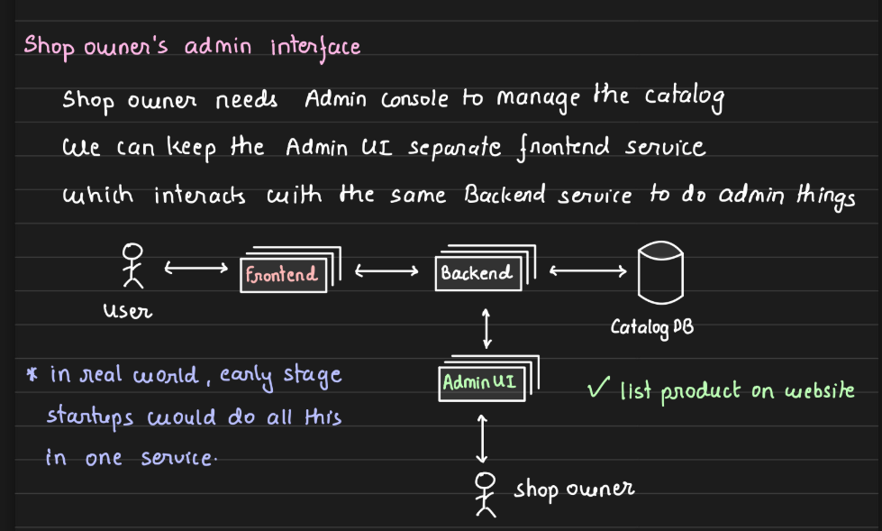
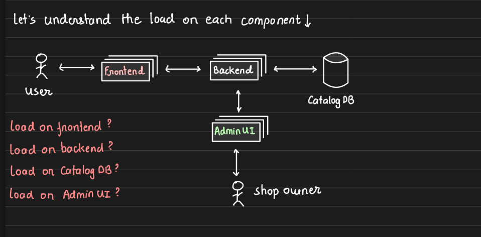
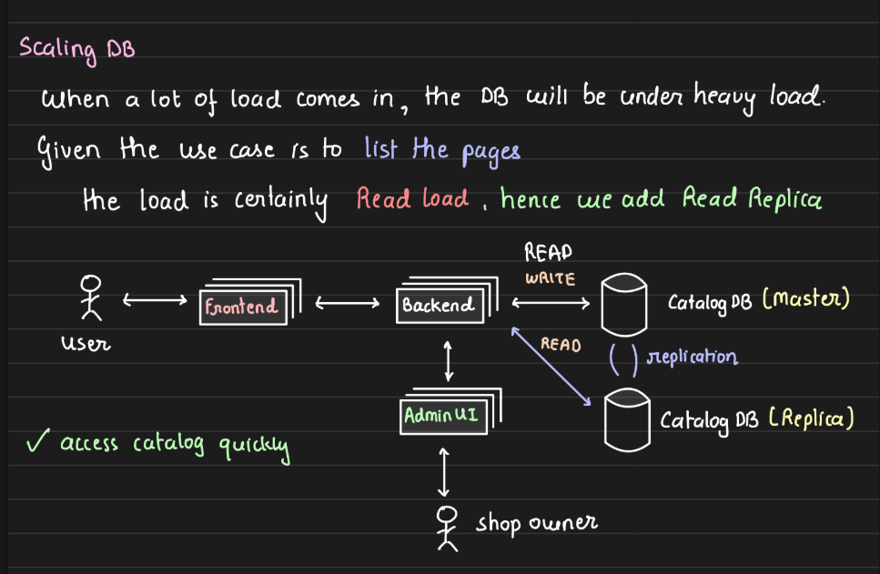

---
tags:
  - sd
  - design
  - hands-on
---
- 100 products so one db works
- for db choice , general use case so simple sql db works 

- user sirf product dekh skte hai ( no payments so read only work )
- admin panel alg se to write to the db 

- considering users are in 1000's , may be multiple servers ki need ho 
- so will add one LB and 3 servers behind it 

- now db scaling part , read heavy product hai hamara ( writes to bhut kam kbhi kbhi hongi as one shop owner only as of now )
- so can add cache , hot data ko rkh lenge 
- coz product details waise bhi jldi change nai hoti 
- lazy population rkhenge jab cache miss hoga then only add to cache 
- and by default most famous ya home page mai dikhane wale products cache mai hi rkhenge 

- agar isse bhi kaam na chale to we can then scale our main db as well .
- read replicas rkh lenge 
- as write is negligible so both master will handle read as well along with rare writes 
- ( ==the point of choosing this approach is to let you know that it is not a hard n fast rule that master only handles write .. depends on the usecase== )

## Arpit Bhayani notes

![[designing_ecomm_product_listing_page.png]]