---
tags:
  - sd
  - design
  - hands-on
---

- interest store krna hai 
- proximity 

- first time user ayga to usse input le lenge 
- plus social login krega to uska page crawl kr lenge 
- ( sync : so that phli baar aaye , tbhi ye api chal jaaye and db fill ho jaye so that we can serve user feed acc to interest only from that time only )
- ( async : may be first time common feed dikhani pde , ya jo user ne input diya uske base p dikha skte hai )
- major advantage of decouplig both api's is preventing cascading effect or simply reducing the latency ki wait kre coz crawl krne mai time lg skta hai 

- proximity store krne ke liye I was thinking of session based req
- like app open krega user , tbhi req kr lenge lat nd longitude ka 
- app close krega to clean the data ya ttl to hoga hi 
- or even better ek ttl rkh skte like 2 hr .. 
- ab app 2 hr ke andar open kiya to nai lenge dubara location 
	- LIVE KYU CHAHIYE EVERY 30 SEC , IDK ??

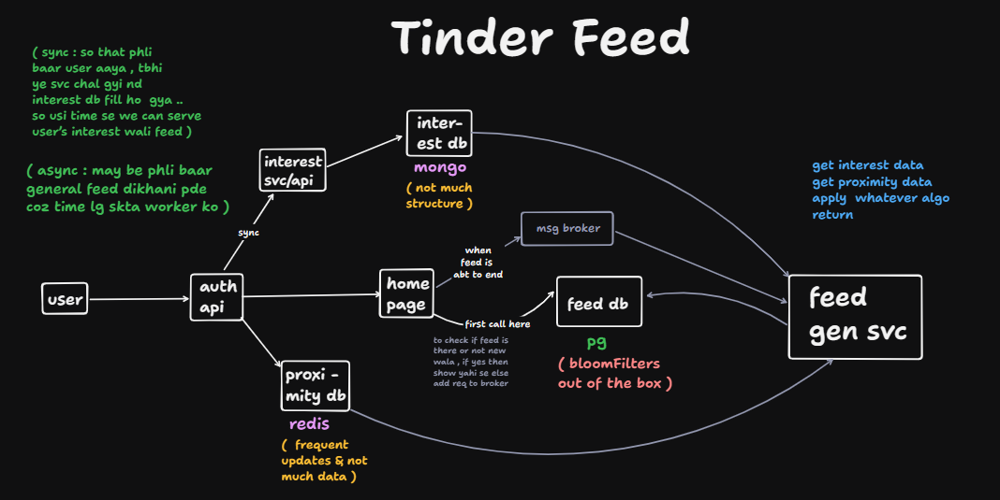

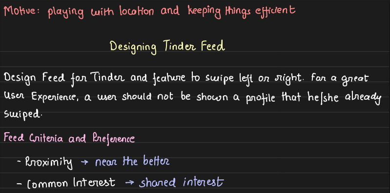
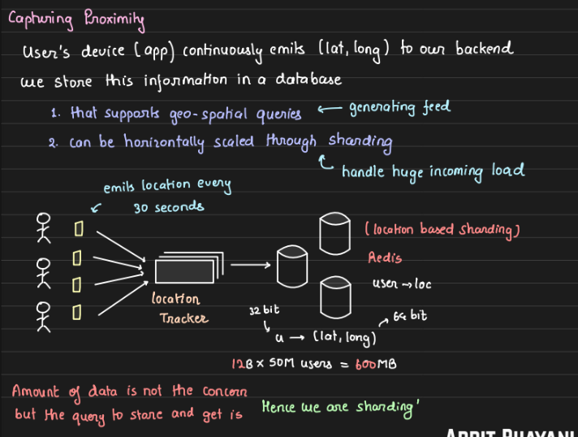
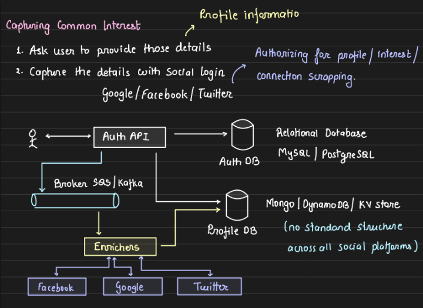
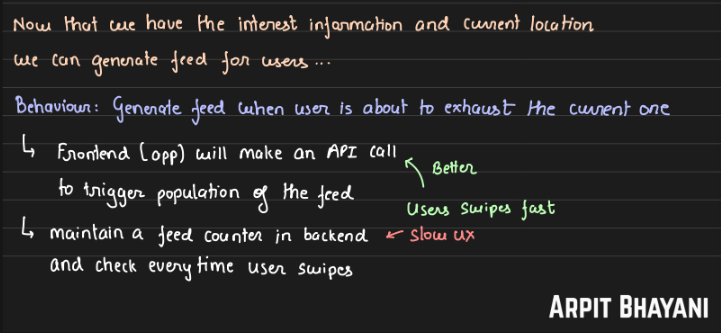
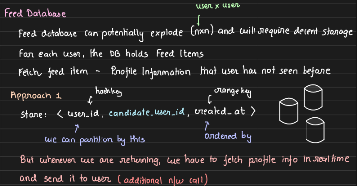
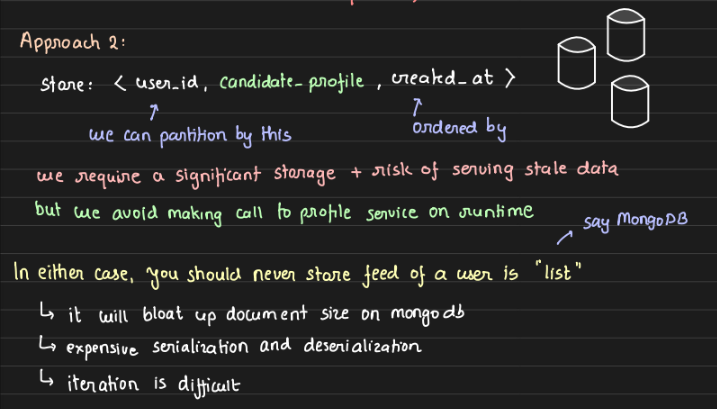
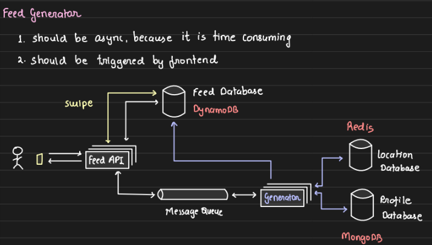
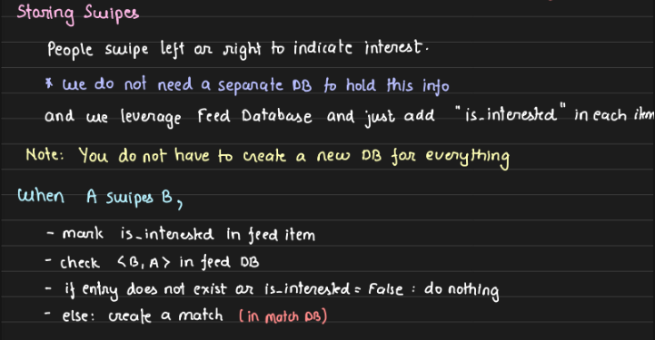
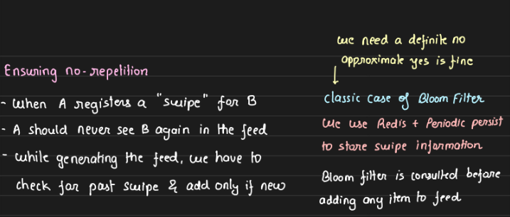
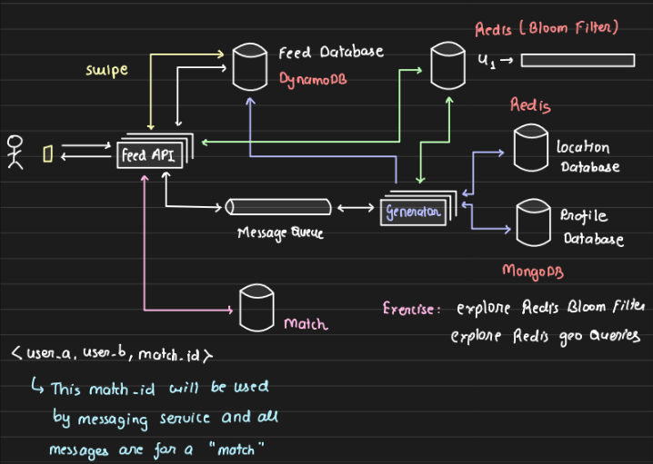