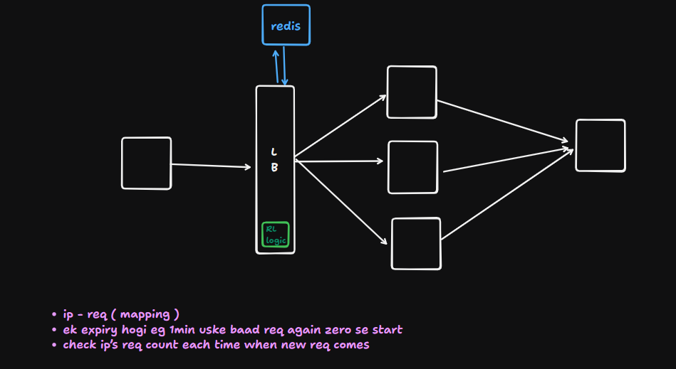

---
tags:
  - sd
  - hands-on
  - design
---
- RL : first line of defense for servers 
- counts , expiry etc store krna hai , check krna hai so : redis db will be better 
- koi alg se service ki need initially to nai hai 
- LB ya proxy mai hi ye logic likh skte 
- direct LB ya proxy ko redis se connect krdo 
- uss redis mai sirf RL ki chize hongi so nothing to worry 

