---
tags:
  - sd
  - hands-on
  - design
---

- realtime ( let say zoom meeting mai ) 
- so ws comes into picture 

- one server , 100 persons connected to it

- someone types someting 
- we have to check each word of it 

- so we have to split each sentence by each person into set of words
- check db ( any storage area where abusive words are already stored )
- if any word in the sentence matches any word in db , mask it ( f*** )
- then show the updated sentence ( if updated else show as it is )

- i built it step by step 
  
		1. main ws server hoga 
		2. waha se abuse masker naam ka ek service hoga 
		3. waha p processing ka logic hoga 
		4. then wo msg broadcast hoga dusre users ko 

- in this system our goal is to understand masker svc not the whole system ( ws , broadcast etc )

### so masker svc ka flow kaise hoga ( by svc id mean ki svc hi hoga alg .. ye clear ho isliye alg draw kr rha but it can be a simple function )

( phle se hi store krna pdega ek jgh words ko )

- sentence aaya server se 
- split it into set of words 
- for each word check into db ( wherver u r storing ) 
- if that word is there in db mask it 
- else do nothing 

### Now two main problems here .. 

#### 1. store kaha kre ? 
	- sirf ek hi to table usme bhi ek col rkhna hai 
	- db overkill ?
	- if not toh konsa db ??

#### 2. check kaise kre ?
	- char by char matching krenge to bhut inefficient hoga 
	- like har word ke liye pura db check kro 
	- ek user ek msg mai 5 word bhi likhega and 100 user baat kr rhe to 
	- has sec 300-400 word 
	- that means 300 qps every sec 

## ( If not able to understand , re-watch the vid )

### My approach :- 

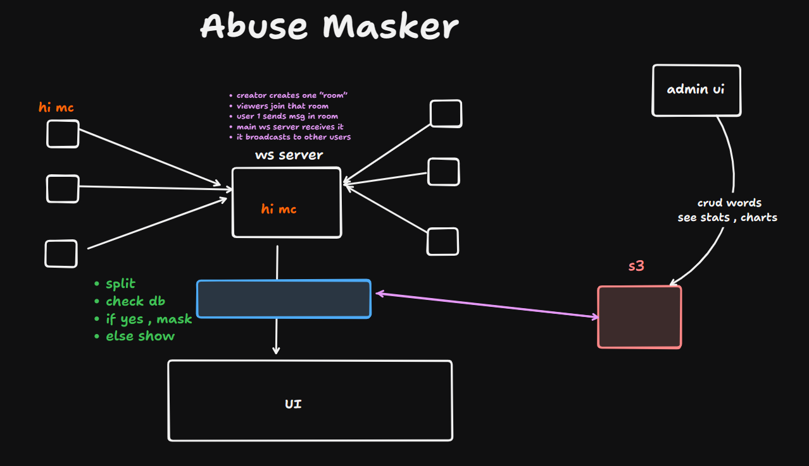

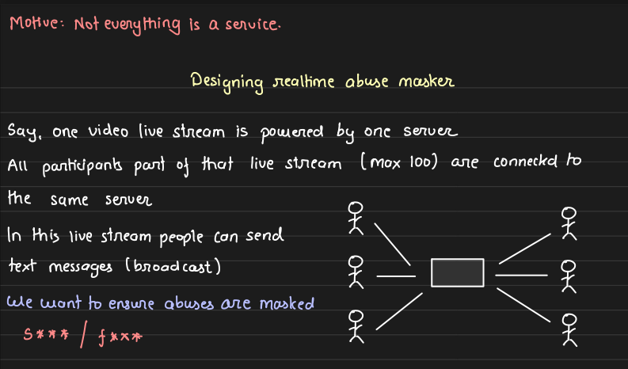
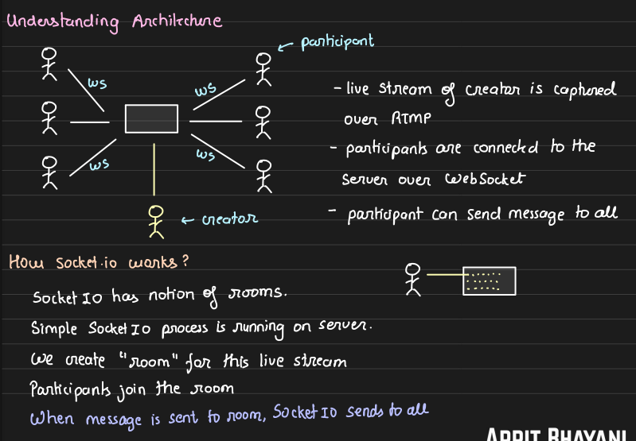
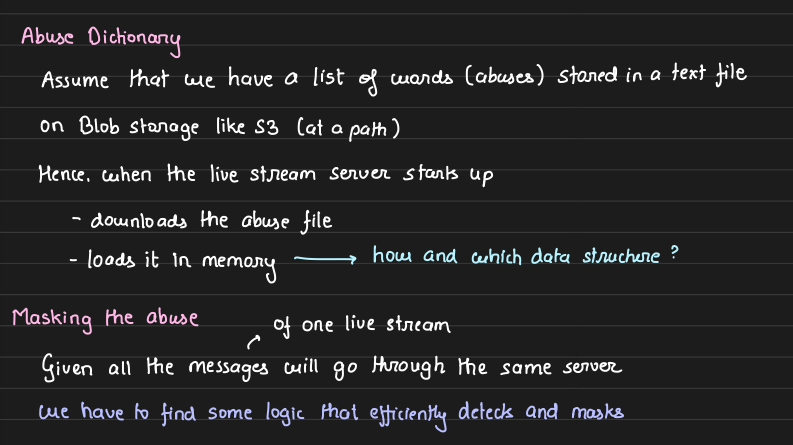
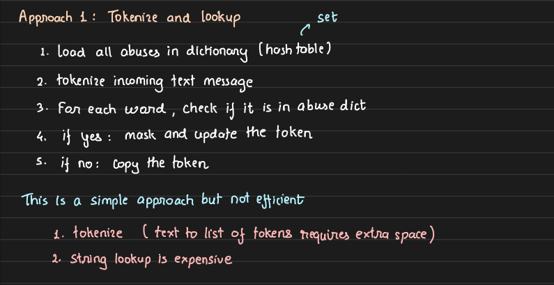
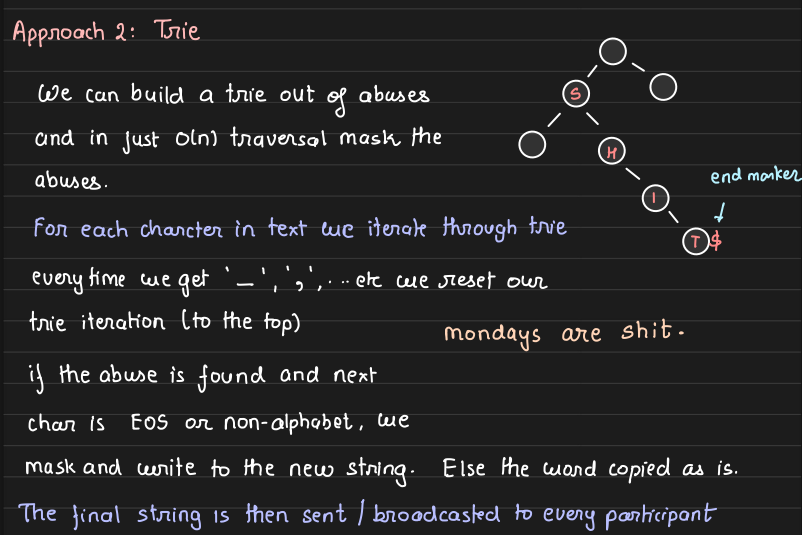
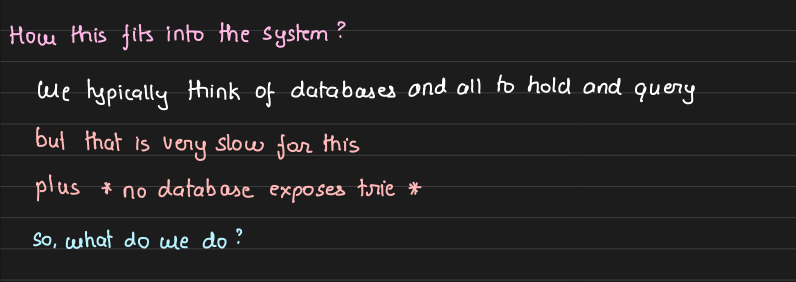
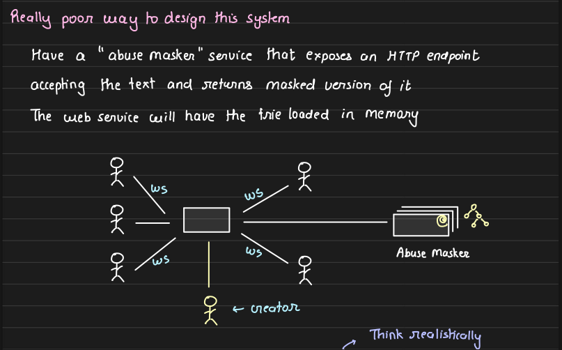
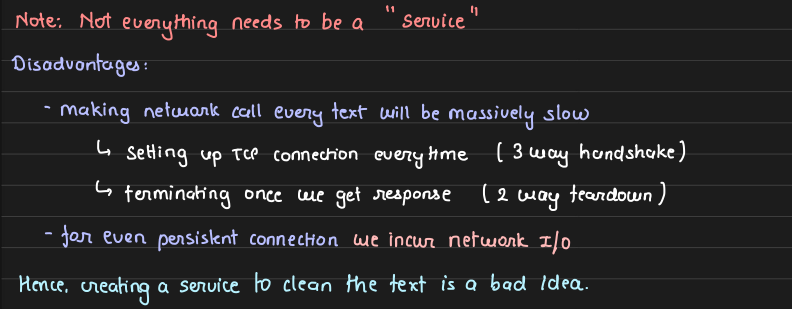
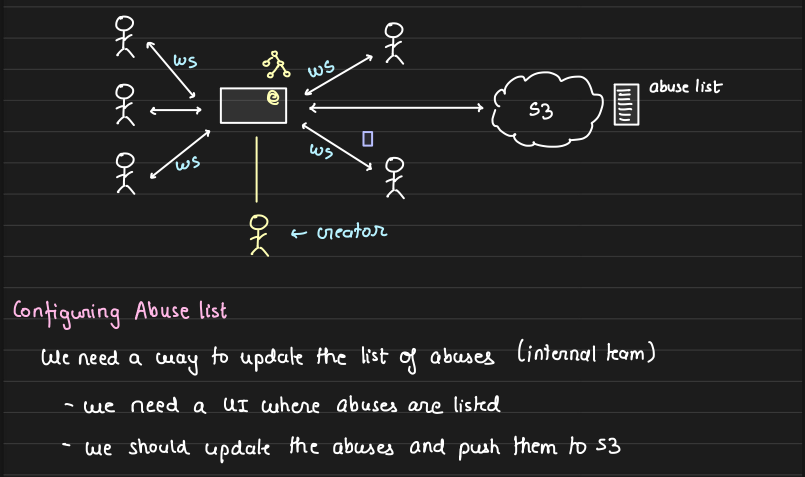
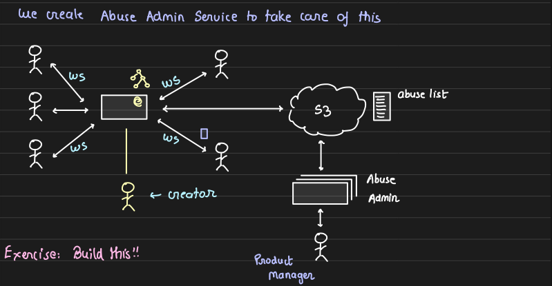
