---
tags:
  - sd
  - hands-on
  - design
---

- get long url
- apply some logic
- shorten it 
- store that in db 

- when someone visits that url 
- check db , get original url 
- redirect the user 

- also admin panel for stats
- so add one broker with server
- new url or url p hi kitna traffic etc sb note krne ke liye 
- async rkha coz turant na ho chalega main objective redirect wala hona chahiye turant 

- cache lgega coz static data hi hai 
- can go with lazy population 

- both main n cache db should be sharded
- coz faster access chahiye 
- main db ke liye , pg would be good

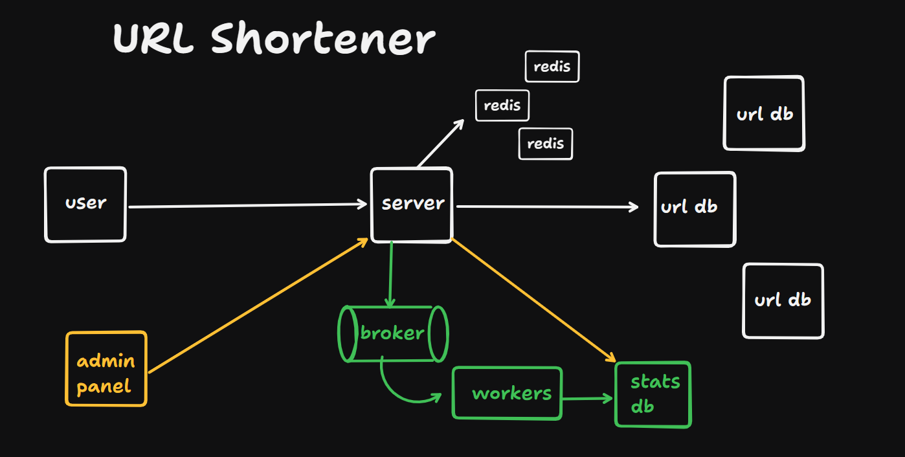

- fsdf

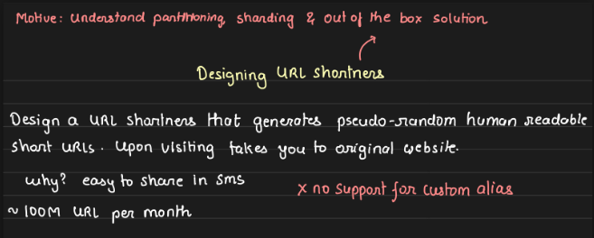
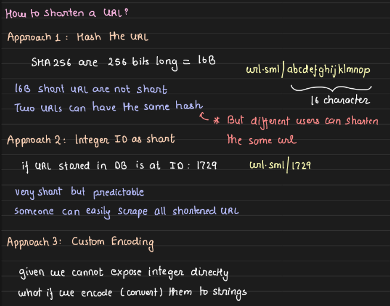
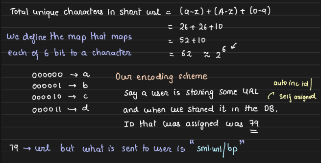
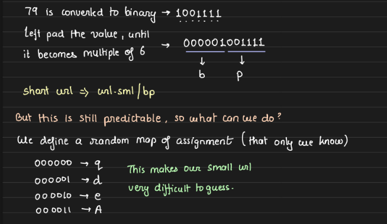
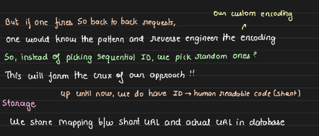
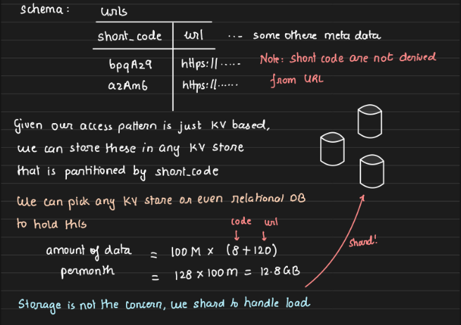
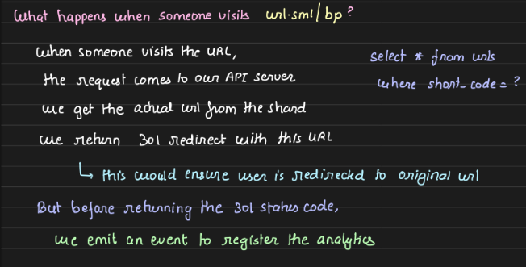
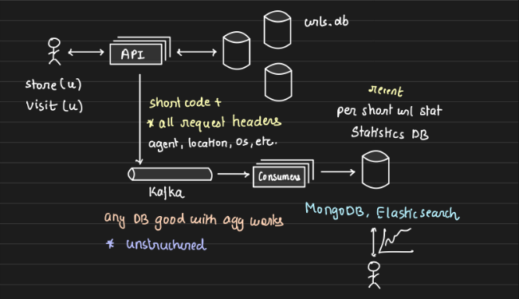
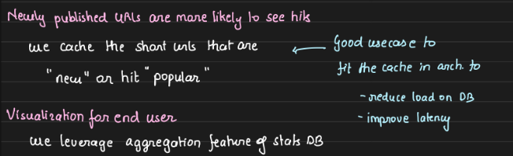
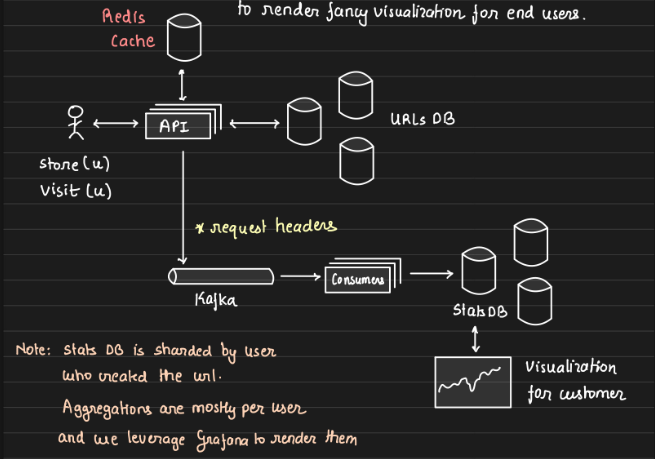
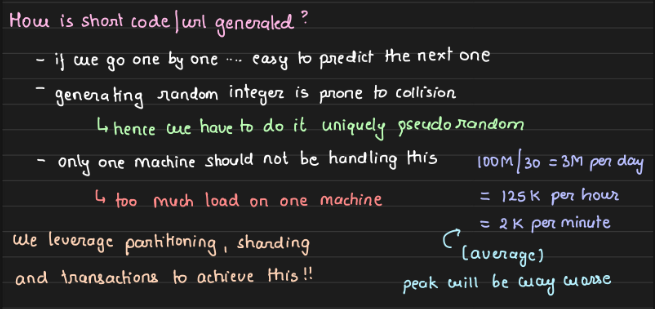
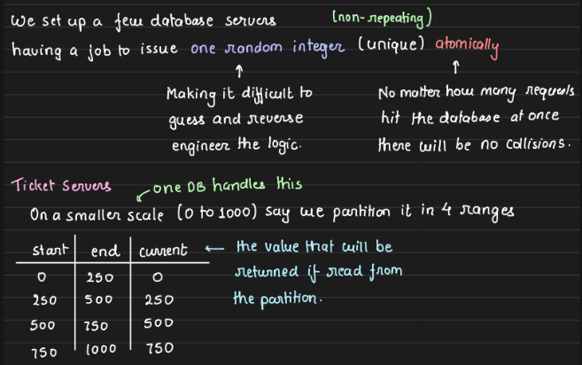
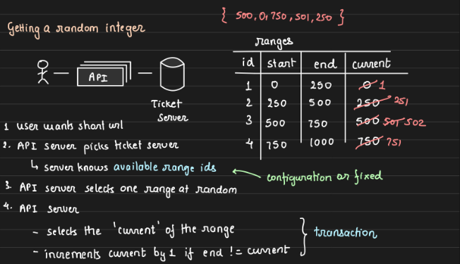
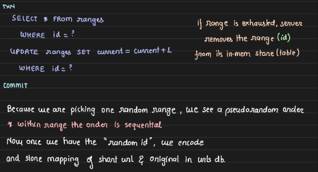
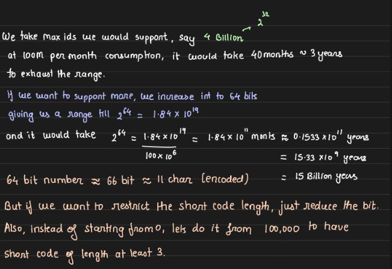
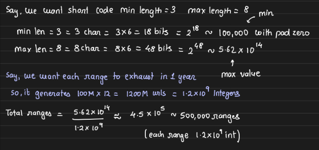
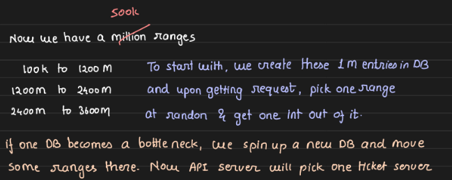
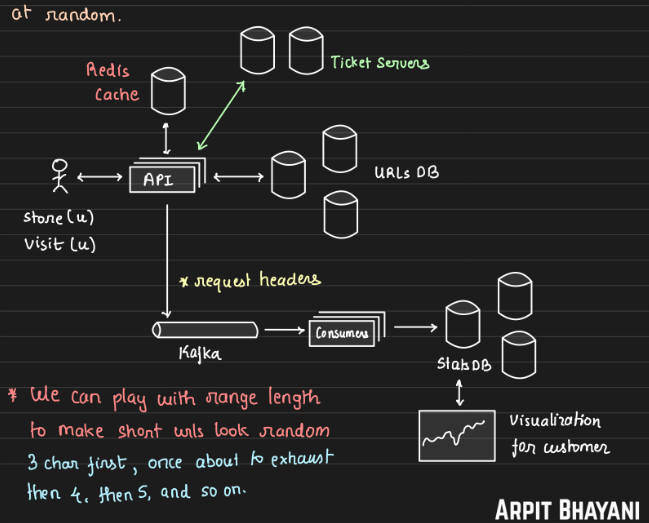

