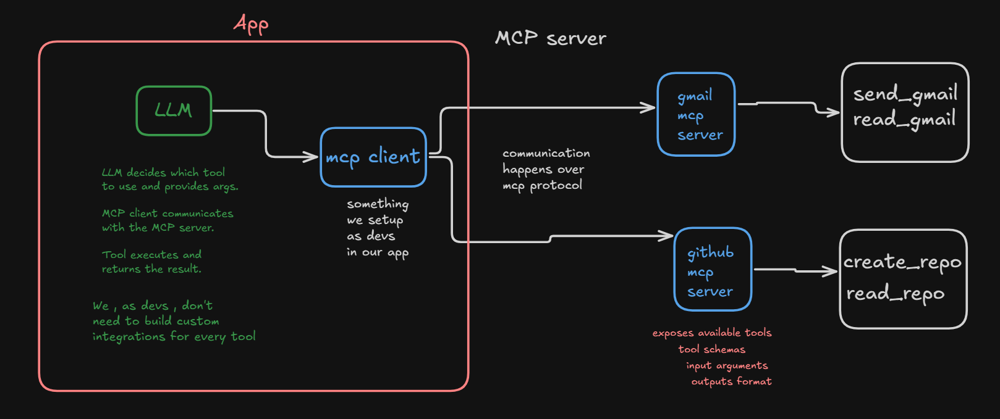

## read more in cohort nd include it there , this is just for refn 

- llm needs tool access
- if llm wants to call read_gmail tool 
- it needs to know input args , output formats etc
- ek ka hai to thik hai , we need 1000's of tools 
- therefore maintaining this is hard 
- saarre tools ke liye fn likhne pdenge 

- so to solve this comes mcp 

### MCP : Model Context Protocol

- Model : any model ( llm , slm etc )
- Context : Context abt tools it's args , output formats etc
- Protocol : rules around it

